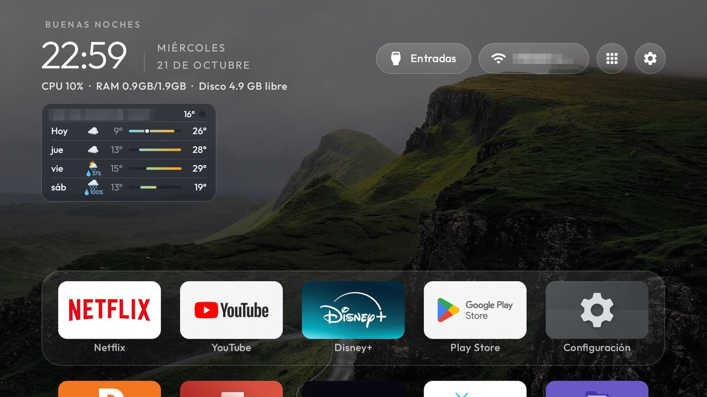

# A TCL G09 build: quick panel, Free memory, dock and weather styles

This branch of [cleanyourtv](https://github.com/Gathin23/cleanyourtv) is the launcher as it runs every day on one
TCL Smart TV Pro. It is upstream as of 21 October 2026 plus the launcher ideas that were too big for the core,
and a few pull requests from other people that were still open then. Everything below is opt-in from `config.xml`,
a theme's `config.json` or Launcher settings on the TV, unless it says otherwise.

## What it adds

**The Settings button.** A press opens a quick settings panel along the right edge, as Google TV's: tiles for the
network, inputs, picture, sound, game mode, accessibility, apps and Free memory, then TV settings and Launcher
settings. Holding OK on the
Settings pill opens a short menu instead: TV settings, Launcher settings, the screensaver, editing the dock and
reordering the apps (`settings_key_panel`, `settings_key_keycodes`; the remote's gear is 83 on TCL).

**Free memory.** The panel's tile, or a remote button listed in `close_apps_keycodes` (TCL's shield button, 4140),
force-stops the apps used in the last six hours. A sideloaded app may not stop other apps on this firmware, so it
does what a person would: Settings, the app, Force stop, OK, checked against the screen at every step, behind a
frozen picture of the screen with a small progress card. The system's click sounds are off while it runs. It
never stops Settings, Play Store, Play services, the Live TV app or a TV input's provider. Needs the
`InputKeyService` helper; the tile menu's Force stop uses the same path.

**Holding OK on a tile.** Next to the tile, without a title: Reorder, Remove from Home, App info, Force stop (only
while the app runs) and Uninstall (apps you installed).

**Dock style in Launcher settings.** Solid, translucent or glass, the glass a softer white than the pills.

**Weather card styles.** On top of johnny1K's card (credited below): solid, translucent or glass, normal or compact,
one to four days, placed under the stats line. The chance of precipitation under a day's icon, from 20 %, reads
💧 on rain and drizzle days and ❄️ on snow days.

**Wallpapers and screensaver.** The rotation fades the next picture in over two seconds, the clock screensaver can
show the theme's wallpapers (`dream_wallpapers`), and the app library is a grid four cards across.

**Remote helpers after a force stop.** Home puts `InputKeyService` and `HomeKeyService` back on the accessibility
list after a force stop took them off, when `WRITE_SECURE_SETTINGS` was granted over ADB.

## From other people

- **Weather card and screensaver button**, by [johnny1K](https://github.com/johnny1K/cleanyourtv/tree/weather-card)
  (Ivan Manolov), with its city search in Launcher settings.
- **Glass dock** (`dock_glass`), by Shivam Singh (upstream #690).
- **Home shortcuts with long-press and Menu**, by nothing531 (upstream #687), which the tile menu above builds on.
- **Spanish date on two lines**, by Oscar Olivera (upstream #725).
- **Back to Home without rebuilding the tiles**, by sim (upstream #666).

## Network and permissions

The weather card is the only network use, and only while it is on: [Open-Meteo](https://open-meteo.com), with the
place's coordinates for the forecast (at most once an hour, while Home is in front) and the city name you type
for the search. Nothing else is sent, and nothing is collected. The app declares `INTERNET` for the card.

Over ADB, optionally: the `InputKeyService` accessibility helper (remote buttons, Free memory), `GET_USAGE_STATS`
(which apps were used lately), and `WRITE_SECURE_SETTINGS` (putting the helpers back, the quiet clicks).

## Tested on

TCL Smart TV Pro, device `G09` (`G09_4K_GB_32BIT`), Google TV 12, firmware `STT2.230203.001.AS24`, Amlogic,
2 GB RAM, with the TCL Bluetooth remote. Build and install as upstream (`launcher/build-and-install.sh`); on TCL
sets also allow `AUTO_START` once, as upstream's `docs/TROUBLESHOOTING.md` says.
